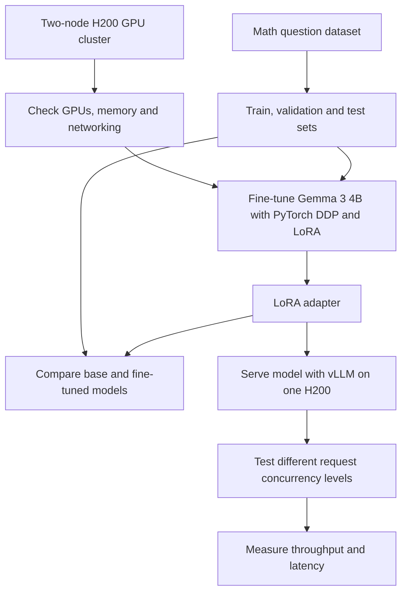
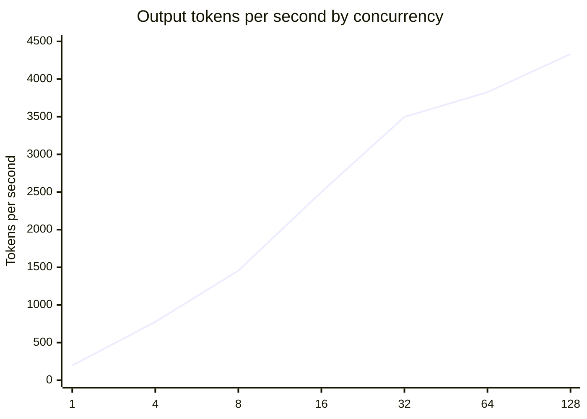

# LLM Systems PoC

I built this project for an AI/ML Solutions Architect technical assessment. The scenario was a startup considering a large GPU deployment for training and serving a language model. Before committing to that setup, the startup needed to know whether the infrastructure could run the workload and how well the model would perform.

I tested the workflow on two NVIDIA H200 nodes, using four GPUs for distributed training. I also served the fine-tuned model on one H200 and measured inference performance.

The main results:
- **Model accuracy:** 35.52% → 41.80% on a held-out set of math questions.
- **Inference throughput:** 196.52 → 4,332.11 output tokens/second as I increased concurrent requests, about **22× higher**. Average request latency also increased.

These are results from a small proof of concept, not a benchmark of the proposed 512-H100 deployment.

## How it works



## Results at a glance

| What I tested | Result |
|---|---|
| Cluster checks | Passed on 4 H200 GPUs across 2 nodes |
| Distributed training | Completed on 2 nodes, 2 GPUs per node |
| Parameters updated with LoRA | 11.9M of 4.31B (0.276%) |
| Accuracy before fine-tuning | 35.52% |
| Accuracy after fine-tuning | 41.80% |
| Accuracy improvement | +6.28 percentage points |
| Inference throughput, 1 concurrent request | 196.52 output tokens/s |
| Inference throughput, 128 concurrent requests | 4,332.11 output tokens/s |

The accuracy numbers come from the same 366-question custom test set, evaluated in the same way before and after training. The throughput results come from a separate test on one H200 GPU.

## Repository layout

```text
llm-systems-poc/
├── README.md
├── cluster-validator/
│   ├── Dockerfile
│   ├── CLUSTER_VALIDATION.md
│   ├── scripts/
│   ├── validator/
│   └── results/
├── training/
│   ├── data/
│   ├── scripts/
│   └── train_lora.py
├── evaluation/
│   └── results/
└── inference/
    ├── benchmark_throughput.py
    ├── run_throughput_sweep.sh
    ├── inference_performance.md
    └── results/
```

Model weights, container images and large training checkpoints are not stored in this repository. The separate live-demo Slurm scripts were not included in the version recovered from GitHub.

## 1. Checking the GPU cluster

Before training, I checked that the GPUs, memory, storage and communication between nodes were working as expected.

The checks covered GPU visibility, BF16 matrix multiplication, memory bandwidth, NCCL communication, InfiniBand, GPU Direct RDMA and shared storage.

| Check | Measured result |
|---|---:|
| GPU memory | ~139.8 GiB per H200 |
| BF16 compute | ~768–806 TFLOPS per GPU |
| HBM bandwidth | ~4.28 TB/s, counting reads and writes |
| NCCL correctness | Passed |
| NCCL network transport | InfiniBand |
| GPU Direct RDMA | Enabled |
| Inter-node AllReduce algorithm bandwidth | 63.17 GB/s |
| Shared storage read | ~920 MB/s |

I used a PyTorch runtime container and added the RDMA libraries needed for NCCL to use InfiniBand rather than socket networking. The container recipe is in `cluster-validator/Dockerfile`.

More details: [Cluster validation notes](cluster-validator/CLUSTER_VALIDATION.md).

## 2. Fine-tuning the model

### Model and data

I used `google/gemma-3-4b-pt`, a pretrained language model with roughly four billion parameters. It was small enough for repeated tests while still letting me try distributed training and inference.

For training, I used multiple-choice math questions from five areas of `cais/mmlu`: elementary mathematics, high school mathematics, high school statistics, college mathematics and abstract algebra.

I removed exact duplicates based on the question and answer choices, then split the data using seed `1234`.

| Split | Questions |
|---|---:|
| Training | 719 |
| Validation | 118 |
| Test | 366 |

I kept the test set separate from training and hyperparameter selection. Because I combined the original dataset splits before making my own, these numbers are **not official MMLU benchmark scores**.

### Training setup

Each question followed this format:

```text
Question: <question>

A. <choice>
B. <choice>
C. <choice>
D. <choice>

Answer:
```

The model was trained to predict the correct answer letter. I used LoRA so I could update a small set of parameters instead of fine-tuning the whole model.

| Setting | Value |
|---|---:|
| LoRA target layers | `q_proj`, `k_proj`, `v_proj`, `o_proj` |
| LoRA rank / alpha / dropout | 16 / 32 / 0.05 |
| Trainable parameters | 11,898,880 of 4,311,978,352 (0.276%) |
| Precision | BF16 |
| Epochs | 3 |
| Learning rate | 2e-4 |
| Weight decay | 0.01 |
| Batch size per GPU | 4 |
| Gradient accumulation | 4 |
| Effective batch size | 64 |

Only the answer token contributed to the training loss; prompt and padding tokens were masked.

I trained with PyTorch DistributedDataParallel (`torchrun`) and NCCL across **four H200 GPUs on two Slurm nodes**. The run finished three epochs and 36 optimizer steps in about 27.4 seconds.

| Epoch | Validation loss |
|---:|---:|
| 1 | 1.529 |
| 2 | 1.273 |
| 3 | 1.297 |

## 3. Evaluating the model

I compared the original model and the fine-tuned model on the same 366 held-out questions, using the same prompt and scoring method.

For each question, I compared the model's next-token scores for `A`, `B`, `C` and `D`, then selected the highest-scoring answer. This was a multiple-choice scoring test, not free-form text generation.

| Math subject | Before | After |
|---|---:|---:|
| Abstract algebra | 22.22% | 25.00% |
| College mathematics | 36.11% | 33.33% |
| Elementary mathematics | 42.97% | 44.53% |
| High school mathematics | 27.17% | 39.13% |
| High school statistics | 39.19% | 52.70% |
| **Overall** | **35.52%** | **41.80%** |

The model went from **130 to 153 correct answers out of 366**, an improvement of **6.28 percentage points**. Four subjects improved; college mathematics did not.

The evaluation code and recorded predictions are in `evaluation/`.

## 4. Serving the model and testing inference

I served the fine-tuned model with **vLLM** on one H200 GPU using an OpenAI-compatible completion API.

I wanted to see how many output tokens the server could produce per second as more requests arrived at the same time. I kept the model, GPU, prompt, number of requests and output length the same, and changed only concurrency.

Each test used **128 requests**, **64 generated tokens per request**, and `temperature=0`.

| Concurrent requests | Output tokens/s | Requests/s | Average request latency |
|---:|---:|---:|---:|
| 1 | 196.52 | 3.07 | 0.326 s |
| 4 | 774.96 | 12.11 | 0.330 s |
| 8 | 1,456.15 | 22.75 | 0.351 s |
| 16 | 2,499.79 | 39.06 | 0.406 s |
| 32 | 3,497.44 | 54.65 | 0.549 s |
| 64 | 3,825.90 | 59.78 | 0.876 s |
| 128 | **4,332.11** | **67.69** | **1.031 s** |



Throughput increased by about **22×** from concurrency 1 to 128. But the average time per request also rose from **0.326 seconds to 1.031 seconds**.

So higher concurrency helped the server process more tokens overall, but individual requests took longer. Concurrency 128 was the best throughput **among the settings I tested**, not necessarily the best setting for a real application.

More details: [Inference performance notes](inference/inference_performance.md).

## Running or reviewing the project

You can clone the code and read the recorded results on a regular computer:

```bash
git clone https://github.com/NanaMaryamMunagah/llm-systems-poc.git
cd llm-systems-poc
```

To reproduce the GPU experiments, you need a compatible NVIDIA GPU setup, Slurm, NCCL networking, the relevant containers, access to the Gemma model and the dataset. The original cluster paths and Slurm settings will need to be changed for another environment. The full project is **not runnable on a CPU-only laptop**.

The main places to start are:

- `cluster-validator/CLUSTER_VALIDATION.md` for the hardware checks.
- `training/` for the distributed fine-tuning code and launch scripts.
- `evaluation/` for baseline and fine-tuned model evaluation.
- `inference/inference_performance.md` for the serving setup and benchmark procedure.

For example, the cluster validator is launched with:

```bash
sbatch cluster-validator/scripts/run_validator.slurm
```

This command requires a configured Slurm cluster; it is not a local Mac command.

## What this project does not cover

This was a proof of concept, not a production deployment. Training was tested on four GPUs across two nodes, while inference was tested on one GPU.

I did **not** test a 512-H100 deployment, so the results should not be scaled up directly.

If I continued the project, I would test larger models, multi-GPU serving, load balancing, more realistic request lengths, p50/p95 latency, longer load tests and recovery from failures.

The main thing I wanted to demonstrate was a working process: **check the infrastructure, train a model, measure whether it improved, and test how it performs when served.**
